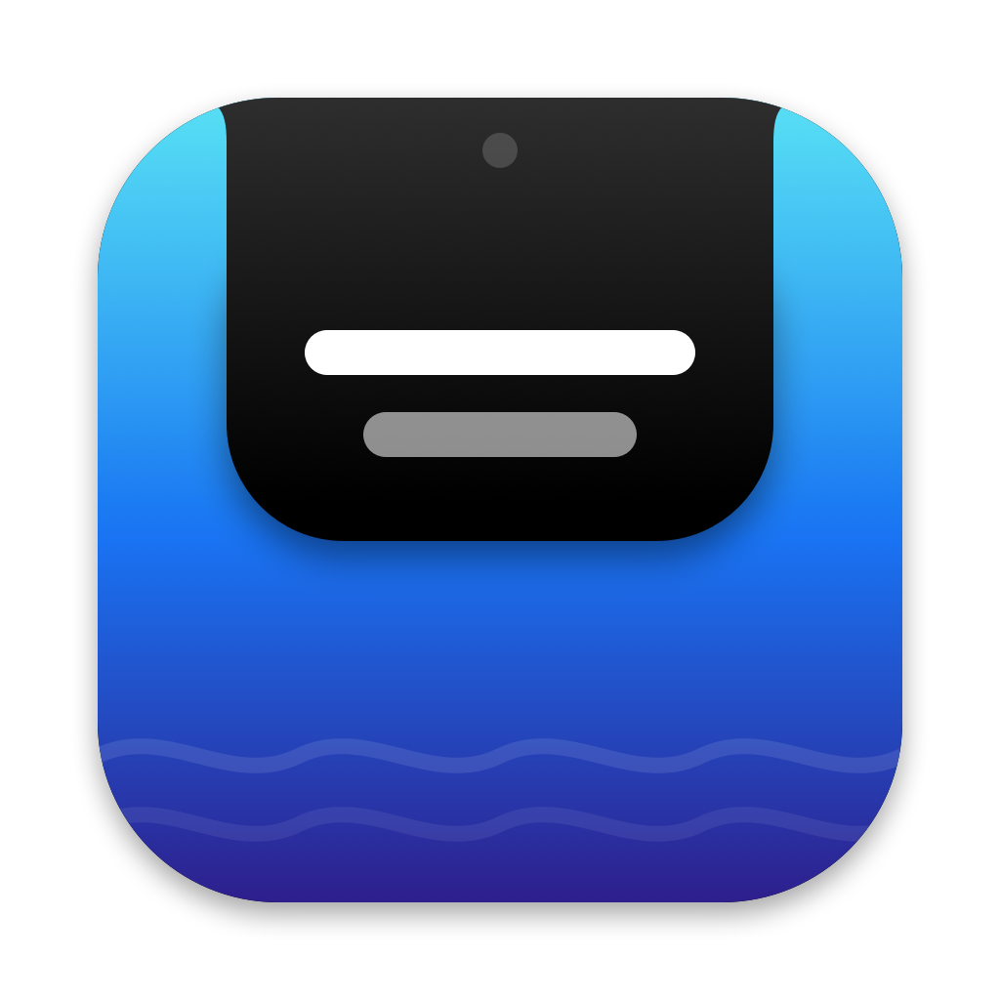

<div align="center">



# 🏝️ Islet

**Субтитры и текст с телефона — прямо в вырезе MacBook.**

Как Dynamic Island на iPhone, только для Mac.


[English](README.md) · **Русский**

</div>

---

```
        ┌──────────────────────────────────────────────┐
        │                  ▀▀▀▀▀▀▀▀                     │  ← вырез MacBook
        │      ╭──────────────────────────────╮        │
        │      │  Следующий слайд — про цены  │        │  ← Islet
        │      ╰──────────────────────────────╯        │
        │                                              │
```

Пишешь на телефоне — текст мгновенно выезжает из выреза на Mac
аккуратным чёрным «островком» и сам прячется, когда больше не нужен.

## ✨ Возможности

- **Живой текст** — появляется по мере набора, без кнопки «отправить»
- **Без приложения на телефоне** — работает в браузере, подходит и iPhone, и Android
- **Подключение по QR-коду** — навёл камеру, и готово
- **Скрыт от демонстрации экрана** — текст видишь ты, а зрители в Zoom / Meet нет\*
- **Анимация как у Dynamic Island** — плавно выезжает из выреза и прячется обратно
- **Автоскрытие** через 7 секунд, размер шрифта 14–24 pt
- **HTTP API** — можно отправлять текст из «Быстрых команд», скриптов, OBS
- **Ничего лишнего** — один процесс, ноль зависимостей, без облака: всё идёт по локальной Wi-Fi

<sub>\* На macOS 15+ некоторые приложения для звонков могут не учитывать этот флаг — проверь заранее (см. ниже).</sub>

## 💡 Для чего

| | |
|---|---|
| 🎤 **Выступления и доклады** | Суфлёр для тезисов: коллега или ты сам подсказываешь с телефона, а на общем экране этого не видно |
| 📹 **Стримы и запись видео** | Подсказки и сценарий прямо под камерой, поэтому взгляд не уходит в сторону |
| 🌍 **Перевод** | Показ перевода из приложения-переводчика на телефоне |
| 🔔 **Уведомления** | Статус сборки, деплоя или таймера через API |

## 📦 Скачать

Возьми свежий `Islet-vX.Y.Z.zip` в [Releases](https://github.com/nukhtarov/Islet/releases), распакуй и перетащи `Islet.app` в «Программы».

Приложение не нотаризовано, поэтому при первом запуске macOS его заблокирует. Нажми на `Islet.app` правой кнопкой и выбери **Открыть**, или выполни:

```bash
xattr -dr com.apple.quarantine /Applications/Islet.app
```

## 🚀 Быстрый старт

```bash
git clone https://github.com/nukhtarov/Islet.git
cd Islet
./build.sh
open Islet.app
```

Нужны только **Command Line Tools** (`xcode-select --install`). Полный Xcode не обязателен.

1. В строке меню появится 💬. Нажми **«Показать QR-код для телефона…»**.
2. Отсканируй код камерой телефона. Mac и телефон должны быть в одной Wi-Fi сети.
3. Пиши — текст уже в вырезе.

> При первом запуске macOS спросит про входящие подключения / локальную сеть. Разреши, иначе телефон не достучится.

## ⚙️ Меню

| Пункт | Что делает |
|---|---|
| `http://192.168.x.x:8765` | Адрес для телефона (клик копирует его) |
| Показать QR-код | QR-код для быстрого подключения |
| Тестовый текст / Скрыть текст | Проверка и ручное скрытие |
| Автоскрытие | Прятать текст через 7 секунд тишины |
| Скрывать при демонстрации экрана | Не показывать Islet в записи экрана и при шаринге |
| Убрать иконку из строки меню | Полностью убрать 💬. Вернуть: снова открыть `Islet.app` |
| Размер шрифта | 14 / 17 / 20 / 24 pt |

## 🔌 API

Сервер слушает порт `8765` в локальной сети.

```bash
# показать текст
curl -X POST --data 'Привет' http://localhost:8765/text

# то же через GET — удобно для ссылок и «Быстрых команд»
curl "http://localhost:8765/text?t=Привет"

# скрыть
curl http://localhost:8765/clear
```

**«Быстрые команды» на iPhone:** действие «Получить содержимое URL» → метод `POST` → тело запроса: текст.

## 🙈 Скрытие от демонстрации экрана

Окно Islet помечено как исключённое из захвата экрана (`NSWindow.sharingType = .none`).
Начиная с macOS 15 Apple ослабила этот механизм, и часть приложений на ScreenCaptureKit
может всё равно показывать окно. Поэтому:

- **перед выступлением проверь** в том приложении, через которое будешь показывать;
- **самый надёжный способ** — показывать одно окно (например, презентацию), а не весь экран.

## 🧱 Устройство

```
Sources/Islet/
├── Notch.swift       окно над вырезом, форма и анимация «островка»
├── Server.swift      минимальный HTTP-сервер на Network.framework
├── PhonePage.swift   страница для телефона (HTML + JS)
└── main.swift        меню в строке меню, QR-код, настройки

Scripts/make-icon.swift   рисует иконку (swift Scripts/make-icon.swift)
.github/workflows/        собирает и публикует релиз на каждый тег v*
```

Разработка в Xcode: `open -a Xcode Package.swift`, затем ⌘R. Перед запуском закрой собранный Islet, иначе порт будет занят.

## 🏷️ Выпуск релиза

Запушь тег с версией, и GitHub Actions соберёт `Islet.app` и опубликует его в Releases:

```bash
git tag v1.0.0
git push origin v1.0.0
```

## 🗺️ Идеи

- [ ] Суфлёр с автопрокруткой длинного текста
- [ ] Несколько строк истории
- [ ] Подписанный и нотаризованный релиз

---

<div align="center">
<sub>Сделано с ☕ и Swift</sub>
</div>
